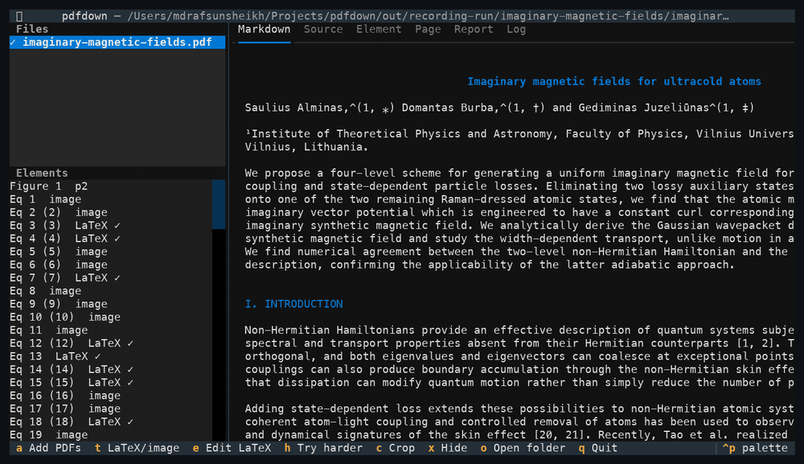
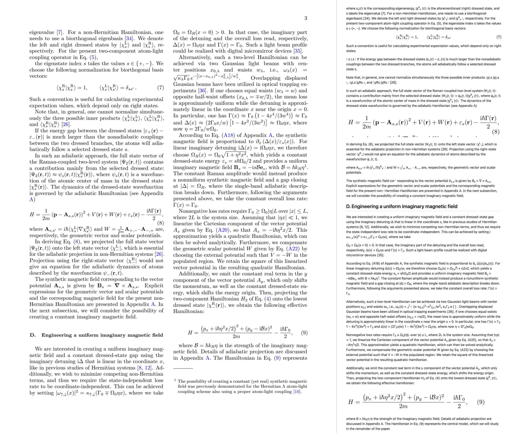
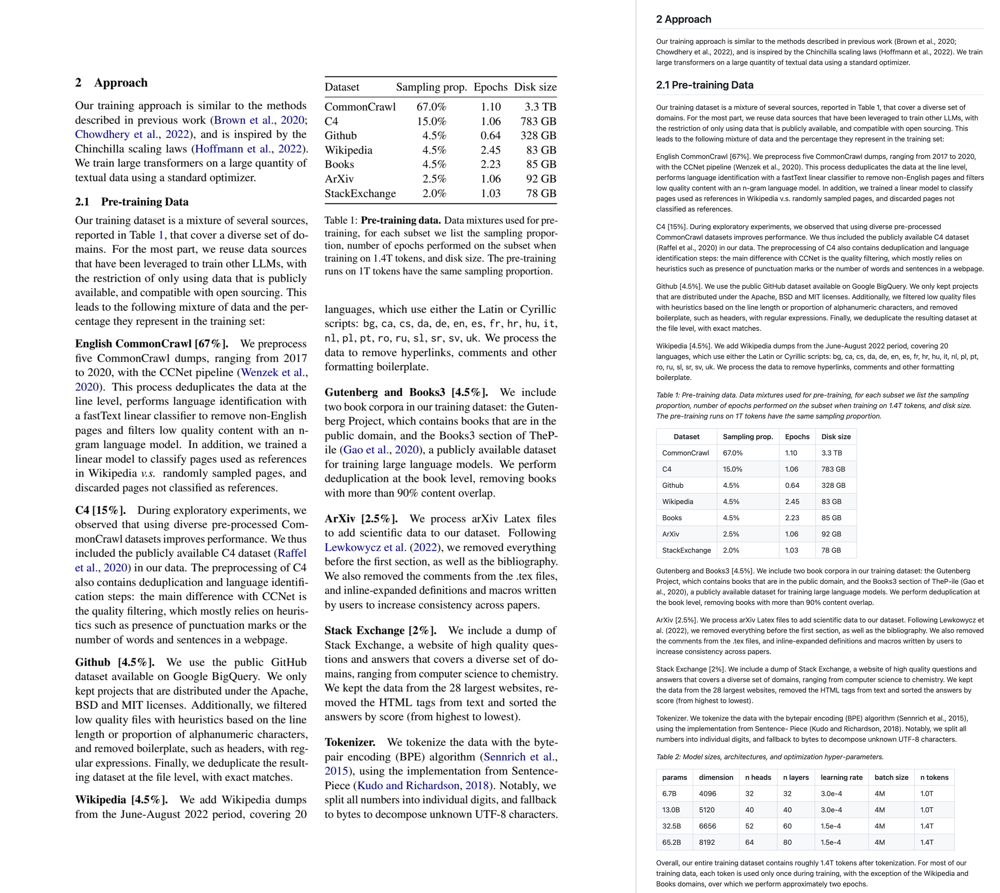
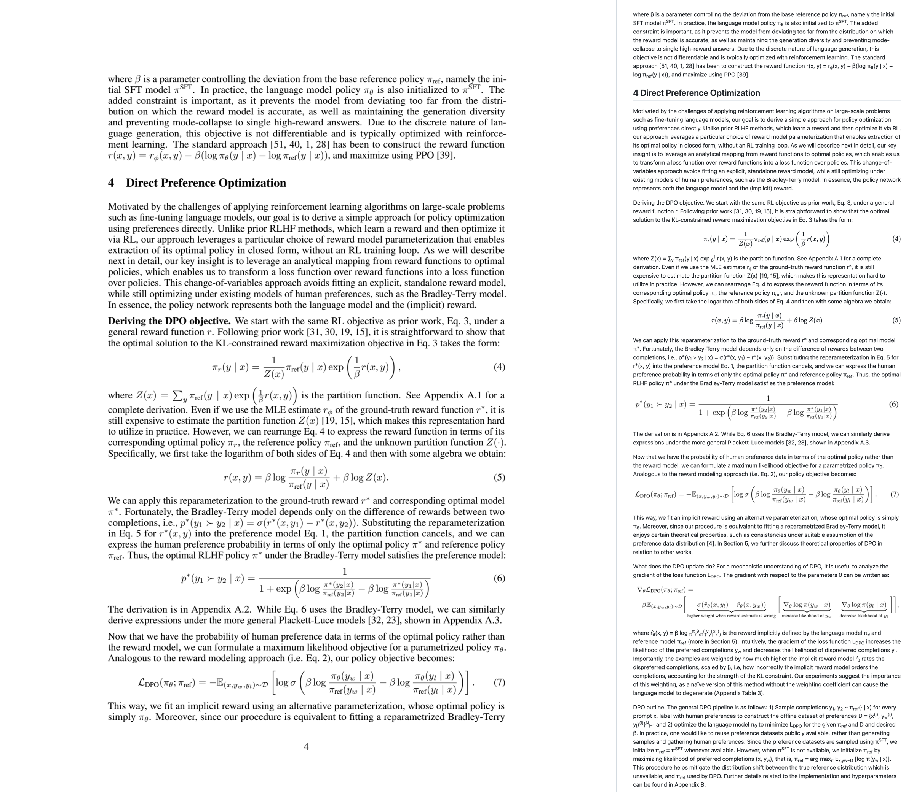

<a id="readme-top"></a>

[![PyPI][pypi-shield]][pypi-url]
[![Python][python-shield]][pypi-url]
[![Issues][issues-shield]][issues-url]
[![npm][npm-shield]][npm-url]
[![License][license-shield]][license-url]

<br />
<div align="center">
  <picture>
    <source media="(prefers-color-scheme: dark)" srcset="https://raw.githubusercontent.com/rafsunsheikh/pdfdown/main/docs/images/logo-dark.svg">
    
  </picture>
  <p align="center">
    A terminal app that turns PDFs, especially research articles, into clean Markdown:
    one column of continuous text, rebuilt tables, cropped figures in the right places, and checked equations.
    <br /><br />
    <a href="#getting-started"><strong>Get started »</strong></a>
    <br /><br />
    <a href="#usage">Usage</a>
    &middot;
    <a href="#examples">Examples</a>
    &middot;
    <a href="#how-it-works">How it works</a>
    &middot;
    <a href="https://github.com/rafsunsheikh/pdfdown/issues">Report Bug</a>
    &middot;
    <a href="https://github.com/rafsunsheikh/pdfdown/issues">Request Feature</a>
  </p>
</div>

<details>
  <summary>Table of Contents</summary>
  <ol>
    <li><a href="#about-the-project">About The Project</a></li>
    <li><a href="#getting-started">Getting Started</a>
      <ul>
        <li><a href="#prerequisites">Prerequisites</a></li>
        <li><a href="#installation">Installation</a></li>
      </ul>
    </li>
    <li><a href="#usage">Usage</a>
      <ul>
        <li><a href="#the-terminal-app">The terminal app</a></li>
        <li><a href="#without-the-app">Without the app</a></li>
        <li><a href="#with-coding-agents">With coding agents</a></li>
        <li><a href="#scanned-pdfs-and-bangla">Scanned PDFs and Bangla</a></li>
        <li><a href="#what-you-get">What you get</a></li>
      </ul>
    </li>
    <li><a href="#examples">Examples</a></li>
    <li><a href="#how-it-works">How it works</a></li>
    <li><a href="#similar-projects">Similar projects</a>
      <ul>
        <li><a href="#why-pdfdown">Why pdfdown</a></li>
        <li><a href="#when-another-tool-is-the-better-choice">When another tool is the better choice</a></li>
      </ul>
    </li>
    <li><a href="#limitations">Limitations</a></li>
    <li><a href="#development">Development</a></li>
    <li><a href="#license">License</a></li>
    <li><a href="#contact">Contact</a></li>
  </ol>
</details>

## About The Project



<sub>Recorded in a terminal without image support, so previews are drawn with coloured blocks. In Ghostty, kitty, WezTerm or iTerm2 they are sharp. ([MP4 version](https://raw.githubusercontent.com/rafsunsheikh/pdfdown/main/docs/images/pdfdown-demo.mp4))</sub>

Copying text out of a research paper usually gives you broken lines, words split by hyphens, two columns mixed together, page headers in the middle of sentences, and no figures. pdfdown gives you a Markdown file you can read, search, quote and edit:

* **Any PDF, research articles first.** Journal articles and preprints, office documents and slides exported to PDF, and scanned pages, which are found and read with OCR by themselves.
* **Bangla too.** Unicode Bangla PDFs, older PDFs set in Bijoy fonts such as SutonnyMJ, and Bangla scans ([details](#scanned-pdfs-and-bangla)).
* **Columns become one column.** Two-column and multi-column pages are read in the right order and written as a single column.
* **Continuous sentences.** Line breaks inside paragraphs are removed and hyphenated words are joined again, so paragraph breaks appear only where the paper has them. A paragraph cut off by a column, page or figure is stitched back together.
* **Tables are rebuilt** as Markdown tables, or as HTML tables when they have merged cells.
* **Figures are cropped** from the page as sharp images and placed exactly where they belong, each followed by its caption.
* **Equations you can trust.** Every equation goes in as a cropped image first. It is replaced by LaTeX only when the LaTeX has been checked against the PDF itself, letter by letter. Otherwise the exact image stays.
* **Superscripts and subscripts survive**, so citations read "prizes<sup>2–9</sup>" and variables read "t<sub>0</sub>".
* **Clutter is removed:** running headers and footers, page numbers, journal badges and axis labels that leaked into the text.
* **You stay in control.** In the terminal app you can switch any equation between LaTeX and image, fix its LaTeX with a live check, adjust any crop, or hide an element. Your changes are kept for the next run.
* **Works with coding agents.** Claude Code and other agents can convert PDFs, read the result section by section, and fix equations through pdfdown's MCP server, under the same LaTeX check ([details](#with-coding-agents)).
* **Private by design.** Everything runs on your own computer. Your PDFs are never uploaded anywhere, so unpublished or confidential papers are safe to convert.

<p align="right">(<a href="#readme-top">back to top</a>)</p>

## Getting Started

### Prerequisites

* macOS or Linux, and **Python 3.11 to 3.14** (or [uv][uv-url], which fetches the right Python by itself).
* About **2.5 GB of free disk space**: about 1.3 GB for the program and about 1.1 GB for the page-reading models, which are downloaded once on first use.
* For sharp image previews inside the app, a terminal that can show pictures, such as Ghostty, kitty, WezTerm or iTerm2. Other terminals show a coarse preview, and the files on disk are full quality either way.

### Installation

**Windows** (Windows 10 or 11, 64-bit): open PowerShell and paste

```powershell
powershell -ExecutionPolicy ByPass -c "irm https://raw.githubusercontent.com/rafsunsheikh/pdfdown/main/install.ps1 | iex"
```

**macOS or Linux:** open a terminal and paste

```bash
curl -LsSf https://raw.githubusercontent.com/rafsunsheikh/pdfdown/main/install.sh | sh
```

The installer adds whatever is missing and skips what is already there:
* on Windows, the Microsoft Visual C++ Runtime (Windows asks for permission once) and Windows Terminal;
* uv, which brings its own Python, so you do not need to install Python;
* pdfdown, with everything it uses, including the OCR engine for scanned Bangla books;
* the models (about 1 GB), so the first PDF converts at full speed and later ones work offline;
* on Windows, a pdfdown shortcut in the Start menu.

It takes 10 to 20 minutes on a home connection. Run the same command again to update pdfdown.

**Other ways**, if you prefer a package manager:

```bash
uv tool install pdfdown                   # then: pdfdown setup
pipx install pdfdown
pip install pdfdown                       # inside a Python 3.11 to 3.14 environment
npm install -g @mdrafsunsheikh/pdfdown    # installs uv (and on Windows the C++ runtime) itself if missing
brew install rafsunsheikh/tap/pdfdown
```

These install pdfdown with everything it uses; the models download on the first conversion, or ahead with `pdfdown setup`. On macOS 14 and older, Bangla scans use a less accurate built-in OCR engine unless the `tesseract` program is installed (`brew install tesseract`; the Homebrew install includes it).

Check it:

```bash
pdfdown --version
```

<p align="right">(<a href="#readme-top">back to top</a>)</p>

## Usage

### The terminal app

```bash
pdfdown                          # open the app and add PDFs with the a key
pdfdown paper.pdf                # open it with a PDF queued
pdfdown papers/                  # queue every PDF in a folder
```

PDFs are converted in the background, one at a time, with a progress bar and a checklist of steps in the Markdown tab (and the percentage in the file list). The first conversion of a long article takes one to a few minutes, mostly reading equations; opening the same PDF again takes seconds. Time estimates learn your computer's speed as you go.

On the left are your files and the figures, tables and equations of the selected one. On the right are tabs:

| Tab | What it shows |
| --- | --- |
| Markdown | the converted document |
| Source | the raw Markdown text |
| Element | the selected figure, table or equation: its crop, its LaTeX, and why the LaTeX was accepted or rejected |
| Page | the whole page, with the crop marked in red |
| Report | what the cleanup changed, and any problems that are left |
| Log | progress messages |

Keys:

| Key | Does |
| --- | --- |
| `a` | add PDFs |
| `t` | switch an equation between LaTeX and image |
| `e` | edit an equation's LaTeX; it is checked against the PDF as you type (Ctrl+S saves) |
| `h` | try harder: read the equation again from sharper and wider crops |
| `c` | adjust a crop: Tab picks the edge, arrows move it, `s` changes the step, Enter saves |
| `x` | hide or show an element |
| `v` | open the selected image in your image viewer |
| `o` | open the output folder |
| `R` | convert the selected PDF again |
| `O` | convert the selected PDF again, reading every page with OCR (for a scan whose built-in text is wrong) |
| `1` to `6` | switch tabs: Markdown, Source, Element, Page, Report, Log |
| `q` | quit |

### Without the app

```bash
pdfdown --batch paper.pdf -o notes/        # convert, print progress, no app
pdfdown --batch papers/ -o notes/          # a whole folder
pdfdown check notes/paper/paper.md         # list problems left in a converted file
```

Options:

| Option | Does |
| --- | --- |
| `-o, --out DIR` | where to write; each PDF gets its own folder (default `./pdfdown-output`) |
| `--no-latex` | keep every equation as an image |
| `--no-tables` | crop tables as images instead of rebuilding them |
| `--ocr auto\|all\|off` | `auto` (default): read pages that have no text layer with OCR; `all` (or just `--ocr`): read every page with OCR, for scans whose built-in text is wrong; `off`: never |
| `--lang bn` | the document is in Bangla (found by itself in most cases); `bn+en` keeps English words too |
| `--device` | `auto` (default), `cpu`, `mps` (Apple GPU) or `cuda` (Nvidia GPU) |
| `--json` | with `--batch`: print one JSON summary (paths, counts, which equations stayed images and why); progress goes to stderr |

### With coding agents

Coding agents such as Claude Code, Cursor or Claude Desktop can use pdfdown themselves through MCP, the standard way agents call outside tools. Connect it once:

```bash
claude mcp add pdfdown -- uvx pdfdown mcp      # Claude Code; other agents take the same command: uvx pdfdown mcp
```

Then just ask, for example: *"Convert ~/papers/attention.pdf and summarise the method section."* The agent gets these tools:

| Tool | What it does |
| --- | --- |
| `convert_pdf` | converts a PDF (options: `ocr` and `language`, for example `bn`); returns where the Markdown is, the counts, which pages were read with OCR, and which equations stayed images and why |
| `markdown_outline` | the headings with line numbers, so the agent can go straight to a section |
| `read_markdown` | reads the Markdown a slice at a time, so a long paper never floods the agent's context |
| `list_elements` | every figure, table and equation, with LaTeX or image status and the reason |
| `get_element_image` | shows the agent the cropped image of one element |
| `set_equation_latex` | lets the agent propose LaTeX for an equation that stayed an image; it is kept only if it passes the same check against the PDF, so an agent cannot put unchecked LaTeX in your Markdown |

Everything still runs on your computer: the agent and pdfdown work on the same files, and nothing is uploaded. Without MCP, any agent that can run commands can use `pdfdown --batch --json paper.pdf` instead.

### Scanned PDFs and Bangla

pdfdown checks every page for a text layer. A page that is only an image, like a scan, is read with OCR (text recognition from the image) without you asking, and the Report says which pages. Everything still runs on your computer.

```bash
pdfdown --batch scan.pdf                 # scanned pages are found and read by themselves
pdfdown --batch --ocr all old-scan.pdf   # read every page, for a scan whose built-in text is wrong
pdfdown --batch boi.pdf                  # a Bangla scan: the language is found from the page images
pdfdown --batch --lang bn+en boi.pdf     # Bangla with English words in it
```

pdfdown finds out by itself that a document is in Bangla, from its text or, for a scan with no text at all, from the shape of the letters on the pages.

How well it reads, measured with `scripts/ocr_bench` on scans made from real papers, where the right text is known (share of words wrong):

| | Clean scan (200 dpi) | Photocopy-like scan (150 dpi, tilted, speckled) |
| --- | --- | --- |
| English (two machine-learning papers) | 2.6% to 3.4% | 5.6% to 9.9% |
| Bangla (three Wikipedia articles) | 2.0% to 4.2% | 15.4% to 20.8% |
| Bangla PDF with real text, no OCR | 8.3% to 17.0% (0.7% to 1.6% of characters) | |

Most Bangla word errors are a single wrong vowel sign or a split word: 0.4% to 0.9% of characters are wrong on clean scans and 7% to 13% on speckled ones. Math-heavy pages read worst, because OCR reads equations as text.

Old books are harder. On a scanned 1970s letterpress novel (207 pages, black and white, 300 dpi), checked against a page typed by hand, 5.5% of the Bangla letters came out wrong (the earlier engine got 34% wrong). pdfdown also repairs the misreadings typical of these books (া read as ৷, the দাঁড়ি । read as 1, quotes read as *), keeps indented dialogue as paragraphs instead of a list, and reads large chapter numbers that the layout analysis takes for pictures (10 of the 12 found). Bold words in heavy ink are often read as Latin letters, so Latin letters are switched off for Bangla: use `--lang bn+en` if the text has English words.

Many Bangla books and newspapers were typeset in older Bijoy fonts (SutonnyMJ, JugantorMJ and similar). Their PDFs store Bangla as Latin letters, so other converters give text like `gvmy` ivbv` instead of `মাসুদ রানা`. pdfdown recognises these fonts and converts the text to Unicode Bangla, putting vowel signs and the reph (রেফ, the র্ written above a letter) in spoken order (`M‡Z©i` becomes `গর্তের`). It also keeps chapter titles that sit on a decorative picture, and removes running headers that are merged into the text. Tested on a 323-page novel: all 15 chapter titles found, no Latin letters left. The letter table comes from [bijoy2unicode](https://github.com/mad-fox/bijoy2unicode) (MIT).

### What you get

For `paper.pdf`, pdfdown writes:

```
pdfdown-output/paper/
├── paper.md               the Markdown
├── figures/figure-1.png   cropped figures (figure-2a.png, figure-2b.png for panels)
├── tables/table-1.png     table crops, used when a table cannot be rebuilt as text
├── equations/eq-1.png     equation crops, used where LaTeX did not pass the check
└── pdfdown-edits.json     the changes you made in the app
```

The Markdown links to its images by relative paths, so keep the folder together when you move or share it.

<p align="right">(<a href="#readme-top">back to top</a>)</p>

## Examples

Three open-access papers (all CC BY 4.0, credited in [`examples/README.md`](examples/README.md)), converted with `pdfdown --batch` and no hand edits. Each folder holds the original PDF, the Markdown, and the cropped figures and equations. Open the Markdown on GitHub to see it rendered, equations included.

| Paper | Layout | Result |
| --- | --- | --- |
| Alminas, Burba and Juzeliūnas, *Imaginary magnetic fields for ultracold atoms* ([arXiv:2610.06793][ex-physics-arxiv]) | two columns, physics journal style, 105 equations | [PDF](examples/imaginary-magnetic-fields/imaginary-magnetic-fields.pdf) · [Markdown](examples/imaginary-magnetic-fields/imaginary-magnetic-fields.md) · 23 equations as checked LaTeX, 82 as images |
| Touvron et al., *LLaMA: Open and Efficient Foundation Language Models* ([arXiv:2302.13971][ex-llama-arxiv]) | two columns, many tables | [PDF](examples/llama/llama.pdf) · [Markdown](examples/llama/llama.md) · 16 tables, all rebuilt as text |
| Rafailov et al., *Direct Preference Optimization* ([arXiv:2305.18290][ex-dpo-arxiv]) | one column, long derivations | [PDF](examples/dpo/dpo.pdf) · [Markdown](examples/dpo/dpo.md) · 11 equations as checked LaTeX, 22 as images |

Each picture shows a page of the PDF on the left and the same part of the Markdown, as GitHub renders it, on the right.

**Two-column physics paper, page 3.** Equation 7 passed the check and became LaTeX. Equations 8 and 9 did not, so they are exact images: the model's reading of equation 9 wrote a plain B where the paper has a calligraphic ℬ, and the check caught it. The text runs on across the column break.



**LLaMA, page 2.** Table 1 is rebuilt as a Markdown table with its caption, and the two columns read as one.



**DPO, page 4.** Equations (4) and (5) are checked LaTeX; (6) and (7) did not pass and are exact images of the originals. Inline formulas stay as text with superscripts and subscripts; stacked fractions inside a sentence come out flattened (see [Limitations](#limitations)).



<p align="right">(<a href="#readme-top">back to top</a>)</p>

## How it works

A PDF doesn't store "paragraphs", "figures" or "columns". It stores drawing instructions: put the letter "A" at this position in this font, draw a line here, paint an image there. pdfdown rebuilds the document's structure from those instructions in five stages.

**1. Find the parts of each page.** Each page is looked at as a picture, the way a person would look at it. Every region gets a box and a label: title, heading, text, figure, table, equation, caption, footnote, page header or page footer. Then the boxes are put in reading order. On a two-column page that means the whole left column from top to bottom, then the right column, which is how the columns become one column. Each table's rows, columns and merged cells are worked out too. This is the slow step, so its result is saved: opening the same PDF again takes about a second.

**2. Rebuild the text from the PDF's own characters.** Every character is read again straight from the PDF, together with its exact position and size:

* *Superscripts and subscripts.* A character smaller than its neighbours and raised becomes a superscript; smaller and lowered becomes a subscript. That is how "prizes2–9" becomes "prizes<sup>2–9</sup>".
* *Hyphenated words.* "interpre-" at the end of one line and "tation" on the next become "interpretation". A hyphen is kept when the paper itself uses the hyphenated word elsewhere, as in "AI-augmented".
* *Line breaks.* The lines of a paragraph are joined into continuous sentences.

**3. Clean up the article.** A chain of small steps undoes the habits of journal layouts:

| Step | What it fixes | Example |
| --- | --- | --- |
| Headers and footers | text repeated near the top or bottom of many pages is removed | the journal name and volume on every page, page numbers |
| Figure text | short text inside or right beside a figure is dropped | axis labels such as "Time" |
| Captions | finds "Fig. 2 \|", "Table 1:" and "Extended Data Fig. 3 \|", joins captions split into pieces, and attaches each one to its figure or table | a caption split across two columns becomes one |
| Stitching | a paragraph that stops mid-sentence is joined to the next one that carries on in lower case; a figure in between moves after it | "...on the basis of" + "41,298,433 papers..." |
| Notes | footnotes and affiliations move to a Notes section at the end | |
| Badges | tiny images without a caption are dropped | a "Check for updates" badge |

**4. Crop figures, tables and equations.** pdfdown does not pull image files out of the PDF, because many figures are not images at all: charts are often drawn as lines and text, and one figure can be made of many pieces. Instead it takes the figure's box, adds a small margin, and draws that part of the page again at three times the PDF's normal resolution. The crop includes everything you see in the box, such as axis labels, panel letters and legends, and line drawings stay sharp.

For example, the box for Figure 2 on page 3 becomes `figures/figure-2.png`, and the Markdown gets:

```markdown


*Fig. 2 | Model accuracy by year...*
```

Tables are written as Markdown tables when they are simple, as HTML tables when they have merged cells, and as the cropped image only when neither works.

Equations go in as cropped images first. Then each crop is read as LaTeX, and the LaTeX replaces the image only when it passes two checks against the PDF:

1. Its letters and digits match the PDF's own characters inside the equation, count for count, and the characters printed small in the PDF are the subscripts and superscripts in the LaTeX.
2. It renders without errors.

So a reading such as "Atention", or "headi" where the paper has "head" with a subscript i, is rejected and the exact image stays. You can always fix it by hand in the app.

**5. Write the Markdown.** The parts are written in reading order: headings, paragraphs, lists, tables, image links with relative paths, and `$$ ... $$` for equations that passed. The changes you made in the app are applied on every run.

<p align="right">(<a href="#readme-top">back to top</a>)</p>

## Similar projects

Several good open-source tools convert PDFs to Markdown. This is how pdfdown compares with four well-known ones, based on their own documentation, licence files and source code as of November 2026.

| | pdfdown | [Marker][marker-url] | [MinerU][mineru-url] | [Nougat][nougat-url] | [MarkItDown][markitdown-url] |
| --- | --- | --- | --- | --- | --- |
| Display equations | LaTeX **only when checked against the PDF**, otherwise the exact image | LaTeX, not checked | LaTeX, not checked | LaTeX, not checked | plain text |
| Inline math | text with superscripts and subscripts | LaTeX | LaTeX | LaTeX | plain text |
| Figures | cropped from the page at 3x, placed with their captions | extracted and linked | cropped and linked | none | none |
| Tables | Markdown, or HTML when cells are merged | Markdown (merged cells flattened) or HTML | HTML | LaTeX | Markdown, guessed from word positions |
| Review and fix results | terminal app: switch, edit and check LaTeX, adjust crops, hide; edits kept | demo web app | web app with layout views | none | none |
| Hardware | laptop CPU or Apple GPU | needs a local model server (vLLM or llama.cpp) | default mode plans for about 8 GB of GPU memory | GPU expected | CPU |
| Licence | code MIT; models Apache 2.0, CDLA-Permissive-2.0 and MIT; no usage caps | code Apache 2.0; model weights free only below $5M funding or revenue | custom licence with user and revenue thresholds and a required attribution | code MIT; base model weights non-commercial | MIT |
| Maintained | yes | yes | yes | no release since 2023 | yes |

### Why pdfdown

1. **It never writes LaTeX it has not checked.** The other model-based tools write whatever their model reads. A model that reads "α" as "a", or drops a subscript, produces an equation that looks right and is wrong, and nothing tells you. pdfdown checks every equation against the characters printed in the PDF and keeps the exact image when they disagree, so an equation in your Markdown is either verified or an image of the original.
2. **You can see and fix every element.** The terminal app lists every figure, table and equation with its crop and the reason for each choice. You can switch an equation between LaTeX and image, fix LaTeX with a live check, move a crop's edges, or hide an element, and your changes are applied again on every re-run. The other tools give you a file and leave the checking to you.
3. **Figures look like the paper.** Each figure is drawn again from its area of the page at three times the normal resolution, so charts made of lines and text stay sharp and keep their axis labels, panel letters and legends.
4. **Simple licensing, simple hardware.** No revenue caps, no non-commercial model weights, no attribution clauses, no GPU server. It installs with one command and runs on a laptop, without sending your PDFs anywhere.

### When another tool is the better choice

* **You need inline math as LaTeX:** Marker or MinerU.
* **Scanned books, handwriting or many languages:** MinerU.
* **Thousands of documents on GPUs:** Marker or MinerU.
* **Word, PowerPoint or e-book files, or a quick text dump for an AI tool:** MarkItDown.

<p align="right">(<a href="#readme-top">back to top</a>)</p>

## Limitations

* **Many equations stay as images.** That is on purpose: LaTeX is used only when it can be verified. In the papers tested, between a fifth and a half of the display equations came out as LaTeX (fewer in notation-heavy physics, more in machine learning papers); you can fix the rest in the app with `e` or `h`.
* **Inline math** inside sentences is kept as text with superscripts and subscripts, not converted to LaTeX. Simple inline math reads well ("λ<sup>t−1</sup>", "W ∈ R<sup>K×H</sup>"), but fractions, roots and stacked symbols inside a sentence come out flattened or out of order, especially in math-heavy physics papers.
* **Scanned pages** lose pdfdown's text repairs: superscripts and subscripts are not restored, and equations stay images, because there is no PDF text to check against. OCR has been measured on clean and photocopy-like scans made from real papers and on one old scanned book (below).
* **Bijoy fonts** have been tested on one book (JugantorMJ). Other Bijoy-family fonts use the same letter table and should work; rare conjuncts may still come out wrong. If a Bangla PDF in another old font comes out garbled, `--ocr all --lang bn` reads the page images instead.
* **Tested by hand on macOS.** Windows, macOS and Linux are tested automatically on every change (the test suite and the one-line installers), but pdfdown has not yet been used on a real Windows laptop. Conversions run on the processor there unless the laptop has an NVIDIA graphics card, so they are slower than on a Mac with Apple silicon.

<p align="right">(<a href="#readme-top">back to top</a>)</p>

## Development

```bash
git clone https://github.com/rafsunsheikh/pdfdown.git
cd pdfdown
uv venv -p 3.12 && uv pip install -e ".[dev]"
.venv/bin/python -m pytest
```

The tests use two sample PDFs in `corpus/` made for this project and the three CC BY papers in `examples/`. Tests that need other well-known papers (for example the BERT, Adam and "Attention Is All You Need" preprints from arXiv) are skipped when those files are not present, because their licences do not allow redistributing them here.

<p align="right">(<a href="#readme-top">back to top</a>)</p>

## License

Distributed under the MIT License. See [`LICENSE`][license-url] for details.

<p align="right">(<a href="#readme-top">back to top</a>)</p>

## Contact

Md Rafsun Sheikh: [github.com/rafsunsheikh][profile-url]

Project link: [github.com/rafsunsheikh/pdfdown][repo-url]

<p align="right">(<a href="#readme-top">back to top</a>)</p>

[pypi-shield]: https://img.shields.io/pypi/v/pdfdown.svg?style=for-the-badge
[pypi-url]: https://pypi.org/project/pdfdown/
[python-shield]: https://img.shields.io/pypi/pyversions/pdfdown.svg?style=for-the-badge
[issues-shield]: https://img.shields.io/github/issues/rafsunsheikh/pdfdown.svg?style=for-the-badge
[issues-url]: https://github.com/rafsunsheikh/pdfdown/issues
[license-shield]: https://img.shields.io/github/license/rafsunsheikh/pdfdown.svg?style=for-the-badge
[license-url]: https://github.com/rafsunsheikh/pdfdown/blob/main/LICENSE
[repo-url]: https://github.com/rafsunsheikh/pdfdown
[profile-url]: https://github.com/rafsunsheikh
[uv-url]: https://docs.astral.sh/uv/
[marker-url]: https://github.com/datalab-to/marker
[mineru-url]: https://github.com/opendatalab/MinerU
[nougat-url]: https://github.com/facebookresearch/nougat
[markitdown-url]: https://github.com/microsoft/markitdown
[ex-physics-arxiv]: https://arxiv.org/abs/2610.06793
[ex-llama-arxiv]: https://arxiv.org/abs/2302.13971
[ex-dpo-arxiv]: https://arxiv.org/abs/2305.18290
[npm-shield]: https://img.shields.io/npm/v/@mdrafsunsheikh/pdfdown.svg?style=for-the-badge
[npm-url]: https://www.npmjs.com/package/@mdrafsunsheikh/pdfdown
