# Imaginary magnetic fields for ultracold atoms

Saulius Alminas,1, ∗ Domantas Burba,1, † and Gediminas Juzeliūnas1, ‡

1Institute of Theoretical Physics and Astronomy, Faculty of Physics, Vilnius University, Saulėtekio 3, LT-10257 Vilnius, Lithuania.

We propose a four-level scheme for generating a uniform imaginary magnetic field for ultracold atoms using Raman coupling and state-dependent particle losses. Eliminating two lossy auxiliary states and subsequently projecting onto one of the two remaining Raman-dressed atomic states, we find that the atomic motion is affected by an imaginary vector potential which is engineered to have a constant curl corresponding to a spatially uniform imaginary synthetic magnetic field. We analytically derive the Gaussian wavepacket dynamics for atoms in such a synthetic magnetic field and study the width-dependent transport, unlike motion in a uniform real magnetic field. We find numerical agreement between the two-level non-Hermitian Hamiltonian and the adiabatic projection description, confirming the applicability of the latter adiabatic approach.

## I. INTRODUCTION

Non-Hermitian Hamiltonians provide an effective description of quantum systems subject to loss and exhibit spectral and transport properties absent from their Hermitian counterparts [1, 2]. Their eigenstates need not be orthogonal, and both eigenvalues and eigenvectors can coalesce at exceptional points [3]. Spatially nonreciprocal couplings can also produce boundary accumulation through the non-Hermitian skin effect [4–6]. These phenomena show that dissipation can modify quantum motion rather than simply reduce the number of particles.

Adding state-dependent loss extends these possibilities to non-Hermitian atomic systems. The combination of coherent atom-light coupling and controlled removal of atoms has been used to observe chiral state transfer [19] and dynamical signatures of the skin effect [20, 21]. Recently, Tao et al. realized a spatially uniform imaginary vector potential in a Raman-coupled Bose-Einstein condensate [22]. Such a vector potential has zero curl. An imaginary magnetic field instead requires a spatially varying imaginary vector potential with a nonzero curl [23].

Ultracold atoms provide a convenient setting for studying such effects in the presence of synthetic gauge fields. In Hermitian systems, atoms adiabatically following a position-dependent dressed state experience (real) geometric vector and scalar potentials [7, 8]. The corresponding (real) synthetic magnetic field allows neutral atoms to simulate the motion of charged particles in a magnetic field [9, 10]. Raman dressing has been used to realize synthetic vector potentials, magnetic fields, and spin-orbit coupling [11–13]. Spatially dependent dark states also provide a means of creating subwavelength geometric potentials and topological optical lattices [14–18].

Imaginary magnetic flux has been studied in two-dimensional lattice models, where it changes the wavefunction norm [24]. Continuum complex magnetic fields and their Landau-level structure have also been considered [23]. Non-Hermitian adiabatic evolution can involve complex geometric phases [25] and geometric vector and scalar potentials [26]. These developments motivate the atom-light coupling scheme studied here, in which a spatially dependent imaginary synthetic vector potential and the corresponding imaginary synthetic magnetic field are obtained by adding controlled particle removal.

Here, we propose a four-level dissipative scheme that separates these effects. Two additional levels provide tuneable losses to each of the two Raman-coupled states, leading to a spatially varying differential imaginary detuning (differential attenuation).

For atoms “dressed” with laser radiation, the synthetic magnetic field depends on both the loss profile and the coherent atom-light coupling. In the two-level Raman configuration considered here, the vector potential is governed by the ratio ∆/√Ω2R − ∆2, where ∆ is the real amplitude of the imaginary differential detuning. A linear detuning at fixed Raman amplitude therefore gives a nonuniform field, with a gap closing at |∆| = ΩR. Moreover, for spatially dependent gauge potentials, removal of atoms from only one of the two Raman-coupled internal states, like in the experiment [22], introduces a scalar loss gradient that affects the motion independently of the magnetic field.

A suitable amplitude of Raman coupling keeps the dressed-state gap constant and yields a uniform imaginary magnetic field. We derive the projected Hamiltonian with unit right-state norm, so that its scalar wavefunction directly determines the physical density. For the resulting quadratic approximation, we obtain the Gaussian first moments and covariance, identify a transverse drift governed by differential attenuation, and compare the prediction with two-level numerical evolution.

The paper is organized as follows. Section II introduces the coupling scheme and its adiabatic reduction. Section III establishes the Gaussian dynamics and analyzes the center-of-mass motion and squeezing dynamics for a launch along y. Section IV considers imaginary Aharonov-Bohm transport, and Sec. V tests the adiabatic approximation. Section VI summarizes the results. The appendices give the general Gaussian solution, geometric potentials, and analytical derivations.

## II. MODEL

## A. Four-level coupling scheme

We consider two Raman-coupled atomic internal states |↑⟩ and |↓⟩, together with two auxiliary states |a↑⟩ and |a↓⟩, as shown in Fig. 1. Each Raman-coupled state |λ⟩, with λ ∈ {↑, ↓}, is coupled to the corresponding auxiliary state by radiation characterized by the Rabi frequency ωλ. The auxiliary states irreversibly decay with loss rates κλ through transitions to independent levels outside the present four-level system. We will not consider these independent levels since there is no population return to the four-level scheme of interest. Thus, the surviving ensemble is described by non-Hermitian evolution [27, 28].

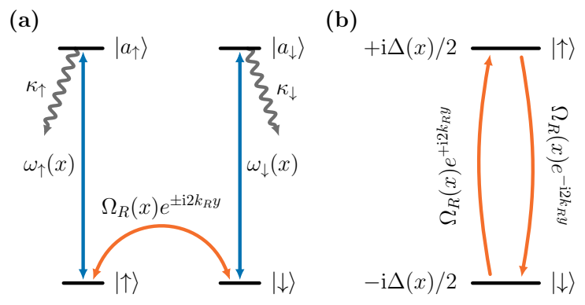

*FIG. 1. Proposed coupling scheme. (a) Raman-coupled system states with independent auxiliary removal channels. The coherent couplings are ΩR and ωλ, and κλ are auxiliary-state decay rates. (b) Effective two-level description with purely imaginary detunings ±i∆(x)/2. The state-independent loss term −iℏΓ(x)/2 featured in Eq. (4) is not shown here.*

In the four-level basis {|↑⟩, |↓⟩, |a↑⟩, |a↓⟩}, the Hamiltonian in the rotating frame is

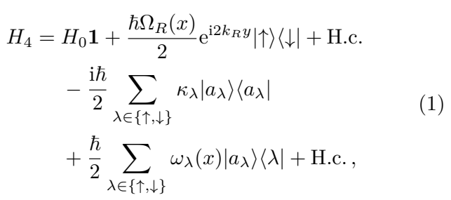

with 1 being the identity operator. Here H0 = p2/(2m) + V (r) is the state-independent part of the Hamiltonian that includes the kinetic energy of atomic motion in the xy plane, as motion along the z axis is frozen; r = (x, y) is a two-dimensional (2D) radius vector, p = −iℏ∇ is the corresponding 2D momentum operator, and m is the atomic mass. As in previous studies [8, 12], we take the amplitude of the Raman coupling ΩR(x) to depend on one spatial coordinate (x) and the Raman phase 2kRy to change in the orthogonal spatial direction y. Thus 2ℏkR represents the Raman momentum transfer and ωR = ℏk2R/(2m) is the corresponding recoil frequency. The auxiliary couplings ωλ(x) are considered to be x-dependent.

## B. Effective two-level description

For sufficiently weak system-auxiliary coupling ωλ and a large enough auxiliary-state loss rate κλ, one can eliminate the auxiliary-state manifold [29, 30], leading to the effective Hamiltonian for the projected subspace of Raman-coupled states. Specifically, we introduce projectors onto the system of interest (P) and auxiliary doublets (Q),

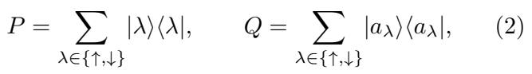

with P + Q = 1. Projection of the stationary Schrödinger equation onto the two subspaces gives

$$
H_{P}(E)=P H_{4}P+P H_{4}Q\,R(E)\,Q H_{4}P \tag{3}
$$

where the resolvent is R(E) = [E− 2i QH4Q − ] 1 −1. We approximate the resolvent as R(E) ≈ − ℏ ∑λ κλ |aλ⟩⟨aλ|. Such an approximation is applicable when the loss rates for the auxiliary states greatly exceed the Raman coupling and the coupling to the auxiliary states, κλ ≫ ΩR, |ωλ|, and ℏκλ is also much larger than the relevant motional energies. This is equivalent to the second-order Schrieffer- Wolff transformation [31–33].

The resulting projected Hamiltonian is

$$
H_{2}=H_{0}{\bf1}+V_{\mathrm{at-l}}({\bf r})-\frac{\mathrm{i}\hbar\Gamma(x)}{2}{\bf1} \tag{4}
$$

where

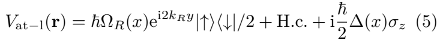

is the atom-light coupling operator, Γ(x) = |ω↑(x)|2/(2κ↑) + |ω↓(x)|2/(2κ↓) is the state-independent loss rate, ∆(x) = |ω↓(x)|2/(2κ↓) − |ω↑(x)|2/(2κ↑) is the effective detuning, and σz = |↑⟩⟨↑| − |↓⟩⟨↓| is the Pauli z operator.

## C. Adiabatic motion in the lowest dressed state

A dressed state |χRs (r)⟩ is an eigenstate of the atom-light coupling operator given by Eq. (5),

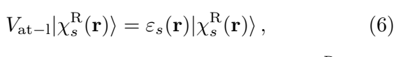

where εs(r) is the corresponding eigenenergy, |χRs (r)⟩ is the aforementioned (right) dressed state, and s labels the eigenvalue [7]. For a non-Hermitian Hamiltonian, one needs to use a biorthogonal eigenbasis [34]. We denote the left and right dressed states by |χLs⟩ and |χRs ⟩, respectively. For the present two-component atom-light coupling operator in Eq. (5), the eigenstate index s takes the values s ∈ {+, −}. We choose the following normalization for biorthogonal basis vectors:

$$
\langle\chi_{s}^{\mathrm{R}}|\chi_{s}^{\mathrm{R}}\rangle=1,\qquad\langle\chi_{s}^{\mathrm{L}}|\chi_{s^{\prime}}^{\mathrm{R}}\rangle=\delta_{s s^{\prime}}\ \tag{7}
$$

Such a convention is useful for calculating experimental expectation values, which depend only on right states.

⟨ s | s ⟩ If the energy gap between the dressed states |ε+(r) − ε−(r)| is much larger than the nonadiabatic couplings between the two dressed branches, the atoms will adiabatically follow a selected dressed state s.

Note that, in general, one cannot normalize simultaneously the three possible inner products ⟨χLs |χLs ⟩, ⟨χLs |χRs ⟩, and ⟨χRs |χRs ⟩ [26].

In such an adiabatic approach, the full state vector of the Raman-coupled two-level system |Ψ2(r, t)⟩ contains a contribution mainly from the selected dressed state: |Ψ2(r, t)⟩ ≈ ψs(r, t)|χRs (r)⟩, where ψs(r, t) is a wavefunction of the atomic center of mass in the dressed state |χRs (r)⟩. The dynamics of the dressed-state wavefunction is governed by the adiabatic Hamiltonian (see Appendix A)

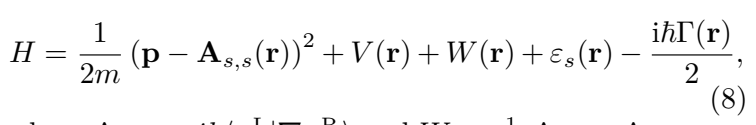

In deriving Eq. (8), we projected the full state vector |Ψ2(r, t)⟩ onto the left state vector ⟨χL−|, which is essential for the adiabatic projection in non-Hermitian systems [26]. Projection using the right-state vector ⟨χR−| would not give an equation for the adiabatic dynamics of atoms described by the wavefunction ψ−(r, t).

where As,s′ = iℏ⟨χLs |∇χRs′ ⟩ and W = 21m A+,− · A−,+ are, respectively, the geometric vector and scalar potentials.

The synthetic magnetic field cor− responding to the vector potential As,s is given by Bs = ∇ × As,s. Explicit expressions for the geometric vector and scalar potentials and the corresponding magnetic field for the present non- Hermitian Hamiltonian are presented in Appendix A. In the next subsection, we will consider the possibility of creating a constant imaginary magnetic field.

## D. Engineering a uniform imaginary magnetic field

We are interested in creating a uniform imaginary magnetic field and a constant dressed-state gap using the imaginary detuning i∆ that is linear in the coordinate x, like in previous studies of Hermitian systems [8, 12]. Additionally, we wish to minimize competing non-Hermitian terms, and thus we require the state-independent loss rate to be coordinate-independent. This can be achieved by setting |ω↑,↓(x)|2 = κ↑,↓(Γ0 ∓ Ω0ηx), where we take

Ω0 = ΩR(x = 0) > 0. In that case, the imaginary part of the detuning and the overall loss read, respectively, ∆(x) = Ω0ηx and Γ(x) = Γ0. Such a light beam profile could be realized with digital micromirror devices [35].

According to Eq. (A18) of Appendix A, the synthetic magnetic field is proportional to ∂x (∆(x)/εs(x)). For linear imaginary detuning i∆(x) = iΩ0ηx, we therefore choose ΩR(x) = Ω0√1 + η2x2, which yields a constant dressed-state energy εs = sℏΩ0/2 and provides a uniform imaginary magnetic field Bs = −isBez, with B = ℏkRη1. The constant Raman amplitude would instead produce a nonuniform synthetic magnetic field and a gap closing at |∆| = ΩR, where the single-band adiabatic description breaks down. Furthermore, following the arguments presented above, we take the constant overall loss rate: Γ(x) = Γ0.

Alternatively, such a two-level Hamiltonian can be achieved via two Gaussian light beams with center positions x0,λ and waists wλ, i.e., ωλ(x) = √ − (x−x0,λ)2−x20,λ /w2λ κλΓ0 e [ ] . Overlapping displaced Gaussian beams have been utilized in optical trapping experiments [36]. If one chooses equal waists (wλ = w) and opposite half-waist offsets (x0,λ = ∓w/2), the mean loss is approximately uniform while the detuning is approximately linear in the coordinate x near the origin x = 0. In particular, one has Γ(x) ≈ Γ0 1 − 4x4/(3w4) ≈ Γ0 and ∆(x) ≈ (2Γ0x/w) 1 − 4x2/(3w2) ≈ Ω0ηx, where now η = 2Γ0/wΩ0.

Nonnegative loss rates require Γ0 ≥ Ω0|η|L over |x| ≤ L, where 2L is the system size. Assuming that |ηx| ≪ 1, we linearize the Cartesian component of the vector potential Ax given by Eq. (A20), so that Ax = −iℏη2x/2. This approximation yields a quadratic Hamiltonian, which can then be solved analytically. Furthermore, we compensate the geometric scalar potential W given by Eq. (A22) by choosing the external potential such that V = −W in the populated region. We retain the square of this linearized vector potential in the resulting quadratic Hamiltonian.

Additionally, we omit the constant real term in the y component of the vector potential Ay, which only shifts the momentum, as well as the constant dressed-state energy, which shifts the energy origin. Then, projecting the two-component Hamiltonian H2 of Eq. (4) onto the lowest dressed state |χR−(r)⟩, we obtain the following effective Hamiltonian:

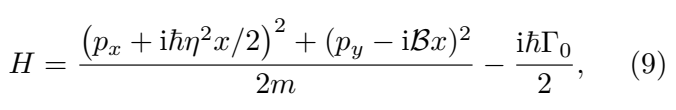

where B = ℏkRη is the strength of the imaginary magnetic field. Details of adiabatic projection are discussed in Appendix A. The Hamiltonian in Eq. (9) represents the central model, which we will study in the remainder of the paper.

## III. GAUSSIAN DYNAMICS IN A UNIFORM IMAGINARY MAGNETIC FIELD

We wish to study the dynamics of a quantum particle in an imaginary magnetic field, governed by the Hamiltonian in Eq. (9). We shall consider a Gaussian wavepacket with arbitrary initial position, mean momentum, and widths. The projected state is |Ψ2(r, 0)⟩ = ψ0(r)|χR−(r)⟩, with envelope

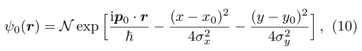

where N = (2πσxσy)−1/2 is the normalization factor, r0 = (x0, y0) is the center position, and p0 = (px0, py0) is the mean momentum. We will also frequently use the wavenumbers, defined by ki0 = pi0/ℏ. The parameters σx and σy are the Gaussian spreads in both spatial directions. The Gaussian wavepacket can be approximately created by preparing the ground state of a harmonic oscillator in one of the system spin states, turning on real detuning and then slowly ramping the atom-light coupling and real detuning so that the state adiabatically follows the lower dressed band, after which the trap is released to initiate the dynamics governed by Eq. (9).

In analogy to the real magnetic field, we define the cyclotron frequency

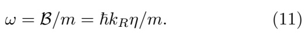

In the rest of this Section, we will first derive expressions for observables in terms of the dressed-state wavefunction. Secondly, we consider the non-Hermitian Ehrenfest equation for the first-order observables and their short-time dynamics. Thirdly, we will compare these predictions with the exact analytical solution. Finally, we shall study the position covariance vij(t) and the associated squeezing dynamics.

Note that one could understand the dynamics by studying the eigenspectrum. However, for non-self-adjoint differential operators, the eigenspectrum can be highly sensitive to perturbations, and one may need to study the pseudospectrum instead [37, 38]. While interesting, we do not pursue this question.

It is noteworthy that wavepacket dynamics affected by non-Hermitian gauge fields was also considered in [23]. Simulations have been carried out in the symmetric gauge with a tight-binding lattice added [23]. On the other hand, we consider continuum wavepacket dynamics in the Landau-type gauge with an extra Cartesian component Ax of the vector potential given by Eq. (A20), which appears after projecting the exact dynamics onto one of the dressed states. The two gauges are related by a nonunitary transformation which changes the wavefunction amplitude. In particular, the same Gaussian profiles are not equivalent in both setups. Furthermore, the paper [23] considered a situation where the real part of the magnetic field is larger than the imaginary part, so the cyclotron motion plays an important role in the dynamics. On the other hand, we are considering another regime in which the dynamics is affected by a purely imaginary magnetic field.

## A. Physical observables

Let us consider nuances of calculating observables for our system. It is simplest to start from the two-component description and then derive expressions for the adiabatically projected model.

For the two-component state |Ψ2(r, t)⟩, the Born rule gives the surviving fraction of atoms and the observable averages,

$$
\begin{array}{l l}{{N(t)=\int\mathrm{d}^{2}r\left\langle\Psi_{2}|\Psi_{2}\right\rangle,}}&{{\qquad\qquad}}\\ {{\langle O\rangle_{t}=\frac{1}{N(t)}\int\mathrm{d}^{2}r\left\langle\Psi_{2}|O|\Psi_{2}\right\rangle.}}&{{\qquad}}\end{array} \tag{12}
$$

Within the adiabatic approximation, |Ψ2(r, t)⟩ = ψ|χR−⟩. Since we have chosen the normalization ⟨χR−|χR−⟩ = 1, the surviving fraction and the position moments are given by

$$
\begin{array}{c}{{N(t)=\int\mathrm{d}^{2}r\,|\psi|^{2},\qquad\qquad\qquad\qquad}}\\ {{\langle r_{i}^{m}r_{j}^{n}\rangle_{t}=\frac{1}{N(t)}\int\mathrm{d}^{2}r\,r_{i}^{m}r_{j}^{n}|\psi|^{2},\qquad\qquad(13)}}\end{array}
$$

where i, j ∈ {x, y} and m, n ∈ N.

∈ { } ∈ For momentum, differentiation also acts on the dressed state; however, we have ⟨χR−|∇χR−⟩ = 0 in the chosen gauge, leading to

$$
\langle\mathbf{p}\rangle_{t}={\frac{1}{N(t)}}\int\mathrm{d}^{2}r\left\langle\Psi_{2}|(-i\hbar\nabla)|\Psi_{2}\right\rangle= \tag{14}
$$

$$
=-\frac{i\hbar}{N(t)}\int\mathrm{d}^{2}r~\left[\psi^{\ast}\nabla\psi+|\psi|^{2}\langle\chi_{-}^{\mathrm{R}}|\nabla\chi_{-}^{\mathrm{R}}\rangle\right]= \tag{15}
$$

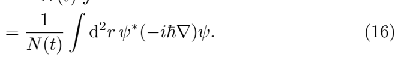

Since we have no vector potential at the level of the two-component system, the kinetic momentum coincides with the canonical momentum. More surprisingly, the mean physical momentum also equals the mean canonical momentum calculated from the projected wavefunction, even though we have a nonzero imaginary magnetic field. This result is in contrast to the real gauge field case, where the kinetic and canonical momenta do not coincide.

Thus, the first-order position and momentum averages reduce to

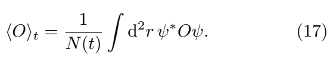

Higher-order observables involving products of momenta generally do not follow this simple reduction and acquire correction terms containing spatial derivatives of the dressed state. Notice that observables involve only the right dressed states. The left dressed states enter only the projection that determines the effective Hamiltonian.

These averages describe measurements on the surviving atoms and will be studied in the following sections.

## B. The non-Hermitian Ehrenfest equation and short-time dynamics

Now we will study the short-time dynamics of observables via the non-Hermitian Ehrenfest equation [22, 39]. We write the first moments as x(t), y(t), px(t), and py(t), and define the position covariance by

$$
v_{i j}(t)=\langle r_{i}r_{j}\rangle_{t}-\langle r_{i}\rangle_{t}\langle r_{j}\rangle_{t},\qquad i,j\in\{x,y\} \tag{18}
$$

The Ehrenfest equation for non-Hermitian systems is given by

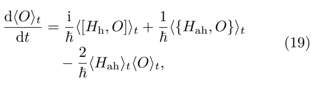

where H = Hh + iHah, with both Hh and Hah Hermitian. Appendix B gives the derivation of this equation.

For the imaginary magnetic field Hamiltonian in Eq. (9), one has

$$
H_{\mathrm{h}}=\frac{{\bf p}^{2}}{2m}-\frac{m\omega^{2}x^{2}}{2}-\frac{\hbar^{2}\eta^{4}x^{2}}{8m_{\mathrm{}}} \tag{20}
$$

$$
H_{\mathrm{ah}}=\frac{\hbar\eta^{2}}{4m}\{x,p_{x}\}-\omega x p_{y}-\frac{\hbar\Gamma_{0}}{2} \tag{21}
$$

The Hermitian part Hh describes an inverted harmonic oscillator. The anti-Hermitian part iHah contains homogeneous loss proportional to Γ0 and nonhomogeneous terms coming from the vector potential A. The −iωxpy term in the Hamiltonian contributes −2ω⟨xpy⟩t/ℏ to the relative rate of change of the surviving fraction, Ṅ/N, leading to different position and momentum components being attenuated at different rates. Such nonuniform loss can give rise to exotic motion like self-acceleration.

Let us consider a special initial condition in Eq. (10), which corresponds to a centered, initially circular packet launched along the Raman direction,

$$
x_{0}=y_{0}=p_{x0}=0,\qquad p_{y0}\neq0,\qquad\sigma_{x}=\sigma_{y}=\sigma.\ \ \tag{22}
$$

Using the Ehrenfest equation of Eq. (19), the short-time dynamics for the position is given by

$$
x(t)=-{\frac{2\omega\sigma^{2}p_{y0}}{\hbar}}\,t+O(t^{3}),\ \ \ \ \ \ \ \ \ \ \ \ \ \ \ \ \ \ \ \tag{23}
$$

$$
y(t)=\frac{p_{y0}}{m}\,t+O(t^{3}) \tag{24}
$$

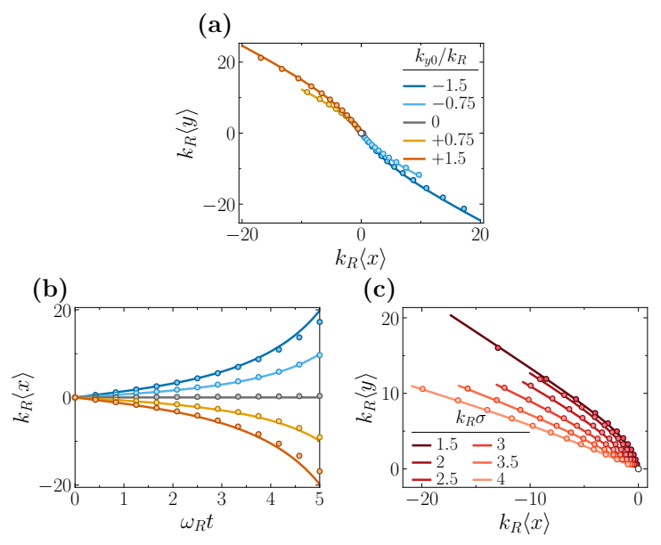

*FIG. 2. Center-of-mass dynamics. (a) Trajectories of an initially centered Gaussian wavepacket for a range of launch momenta ky0/kR. (b) Corresponding x center-of-mass evolution, with fixed width kRσ = kRσx = kRσy = 3/√2. (c) Trajectories of an initially centered Gaussian wavepacket for a range of different initial widths kRσ, with fixed initial momentum ky0/kR = 0.75. Markers are exact numerical results of the projected model using the precise form of Ax given by Eq. (A20), and solid curves are analytical results of the projected model, obtained by linearizing Ax. Here kx0/kR = 0 and η/kR = 0.05.*

The vector-potential cross term −iωxpy in the Hamiltonian attenuates the two sides of the moving packet at different rates. Over time, the side with ωxpy0 &lt; 0 experiences less loss, leading to center-of-mass motion with velocity proportional to py0. Additionally, the anticommutator terms in the Ehrenfest equation lead to width-dependent dynamics of the first position moments. For arbitrary initial states, anti-Hermitian terms couple nth-order moments to (n + 2)th-order moments. However, for the case of the Gaussian wavepacket, the higher-order moments simplify into first- and second-order moments. In particular, broader wavepackets experience larger transverse drift. The following dynamics is different from the real magnetic field case, where the first-order moments do not couple to higher moments.

Analyzing short-time dynamics for the momenta, one has

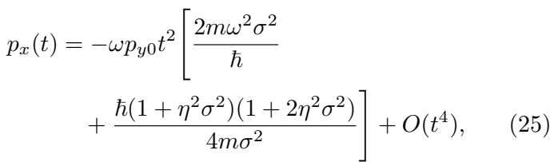

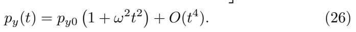

We see that the transverse momentum px(t) grows quadratically in time due to the xpy term in the Hamiltonian. The magnitude of growth is governed by both position and momentum uncertainties. Terms proportional to σ2 describe initial position uncertainty, whereas terms proportional to 1/σ2 describe initial momentum uncertainty via the Heisenberg uncertainty principle.

At fixed initial width, both displacements are proportional to the launch momentum py0. Reversing the launch direction, i.e., py0 → −py0, therefore reflects the entire trajectory through the origin, while increasing its magnitude increases the spatial excursion, as illustrated in Fig. 2(a) and Fig. 2(b).

Although [H, py] = 0, the longitudinal momentum py(t) changes because different momentum components decay at different rates. Thus, the initial transverse drift precedes momentum deflection, while the longitudinal acceleration results from momentum-selective loss.

The width dependence in Fig. 2(c) reflects the coupling between the center-of-mass position and the wavepacket spread. Over the range shown, broader packets undergo a larger transverse displacement along x at a given longitudinal position. They sample a greater variation in attenuation across x, producing a stronger redistribution of the surviving density.

## C. Exact analytical solution

The quadratic projected Hamiltonian in Eq. (9) preserves Gaussian wavepackets and is analytically solvable. A nonunitary transformation to eliminate Ax, followed by an imaginary position shift to eliminate Ay, reduces each conserved py sector to an inverted harmonic oscillator. Then one may evolve the wavefunction via the inverted-oscillator propagator and transform back to obtain the dynamics of the dressed-state wavefunction. Once the wavefunction is found, we calculate the first moments, the position covariances, and the surviving fraction of atoms. The detailed derivation is given in Appendix C.

For the centered launch along y, i.e., x0 = y0 = px0 = 0, py0 ̸= 0, and σx = σy = σ, the four first moments reduce to

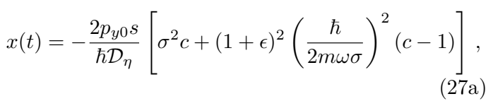

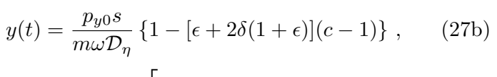

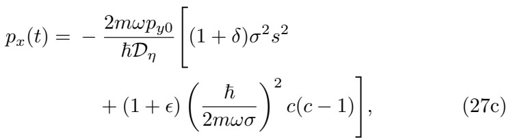

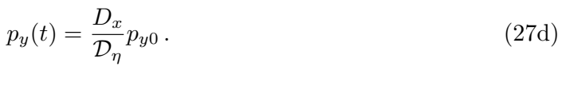

Here c = cosh(ωt), s = sinh(ωt), ϵ = η2σ2, and δ =

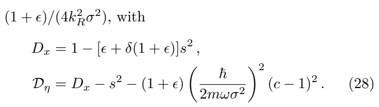

For our considered time interval, we have Dη > 0. Eventually, Dη reaches zero, indicating the breakdown of the quadratic description.

Expanding Eq. (27) reproduces the short-time results: x and y grow linearly in time, while px and py − py0 grow quadratically. The transverse density shift therefore precedes the buildup of transverse momentum.

The exact analytical solutions describe dynamics beyond the short-time expansion, e.g., the departure from the initial straight trajectory: the transverse displacement grows increasingly rapidly relative to the longitudinal displacement as the packet evolves.

All the aforementioned dynamics are also observed in exact numerics, shown in Fig. 3. Even for zero launch momentum, the packet develops an inclined density profile while its center remains at the origin, as seen in Fig. 3(a). A finite positive launch momentum additionally produces propagation along y and a transverse displacement toward negative x, evident in Fig. 3(b). The density profiles thus reveal both the displacement of the surviving cloud and its deformation about the moving center.

## D. Position correlations and squeezing of the launched packet

We now study how the packet spreads about its moving center. The position covariance matrix is

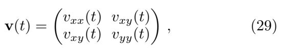

where vij(t) is given by Eq. (18). The diagonal entries are the position variances, with standard deviations σx(t) = √vxx(t) and σy(t) = √vyy(t). The off-diagonal entry vxy describes correlations between the two coordinates. For the initially circular packet of Eq. (22), v(0) = σ212.

Expanding the exact covariance in Appendix C 3 gives

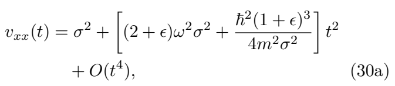

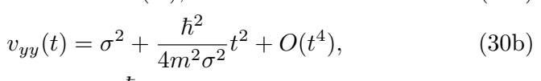

$$
v_{x y}(t)=-\frac{\hbar\omega}{4m}(3+\epsilon)t^{2}+O(t^{4}),\qquad\qquad\qquad(30\mathrm{c)}
$$

where ϵ = η2σ2. Both laboratory variances initially increase. The terms proportional to σ2 and 1/σ2 again describe the contributions of initial position and momentum uncertainty. These expressions depend on the initial spreads, but not on the first moments. This independence also holds for the exact covariance with unequal initial widths. Thus, changing the launch momentum changes the center-of-mass motion and surviving population, while leaving the normalized shape unchanged. Uniform loss likewise cancels from the covariance.

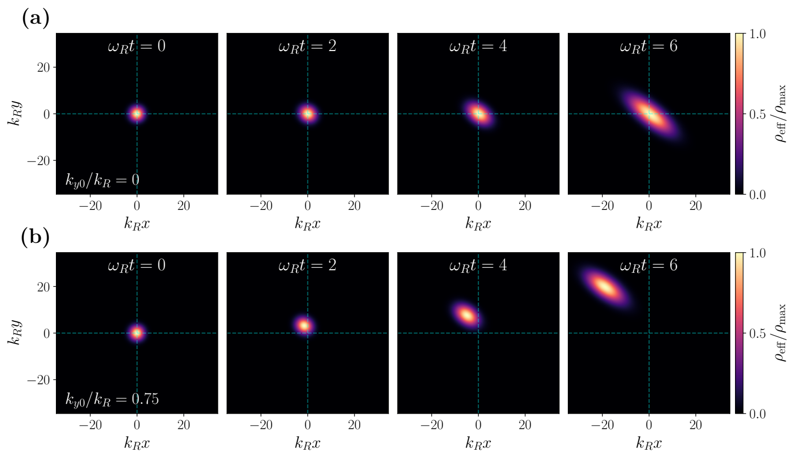

*FIG. 3. Density evolution. Results are obtained by exact numerics of the projected model using the precise form of Ax given by Eq. (A20). (a) Density profiles for an initially centered Gaussian wavepacket with kx0 = 0 and ky0 = 0. (b) Same as in (a), but for ky0 = 0.75 kR. Snapshots are shown at the times indicated in the panels. Here kRσx = kRσy = 3/√2 and η/kR = 0.05. Each density is normalized to its instantaneous maximum, ρmax(t), so the color scale displays the spatial evolution of the wavepacket rather than changes in its absolute population.*

The spreads along the principal axes follow from the eigenvalues λ+ ≥ λ− of v,

For the separable initial state considered here, the crosscovariance vxy is generated by the imaginary magnetic field and vanishes in its absence. This correlation tilts the density ellipse away from the laboratory axes. Its orientation generally changes with time, giving a rotation of the squeezing axes. Reversing the field changes the sign of vxy and reflects these axes, while leaving the principal spreads unchanged.

$$
\lambda_{\pm}=\frac{v_{x x}+v_{y y}}{2}\pm\frac{1}{2}\sqrt{(v_{x x}-v_{y y})^{2}+4v_{x y}^{2}} \tag{31}
$$

The corresponding orthogonal eigenvectors are

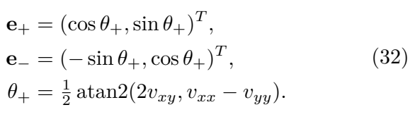

The maximum spread is √λ+ along e+, and the minimum spread is √λ− along e−. Initially the two eigenvalues coincide, so the circular density has no preferred direction. The directions become defined as the packet deforms.

Although vxx and vyy both grow, the correlations can reduce λ− below its initial value. Substitution of Eq. (30) into Eq. (31) shows that one principal spread initially increases while the other decreases when

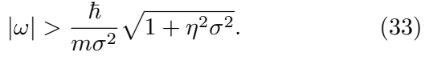

Below this threshold, both principal spreads initially increase. At equality, the exact solution gives λ−(t) = σ2 and fixed principal directions throughout the normalizable evolution, while λ+(t) increases. Appendix C 4 gives the derivation and the finite-time expressions. Thus the eigenvalues determine the broadening and narrowing, and the eigenvectors give the orientation of the squeezed packet.

The origin of these effects can be understood from the transformed Hamiltonian. The inverted harmonic oscillator p2x/(2m) − mω2x2/2 generates squeezing of conjugate quadratures in the x, px phase plane. On its own, it does not couple x and y and therefore cannot rotate the spatial density ellipse of an initially separable packet. The imaginary-field coupling −iωxpy, together with kinetic propagation, generates vxy and the rotation of the spatial squeezing axes. It also changes the principal spreads, so the spatial narrowing condition in Eq. (33) is a property of the full dynamics. The resulting spreads and their orientation can be measured directly from the density profiles.

## IV. IMAGINARY AHARONOV-BOHM TRANSPORT

An imaginary magnetic flux changes the amplitude acquired during transport around a closed path. We study this effect by moving a localized trapped mode through a uniform imaginary field and comparing the surviving populations for opposite orientations. The ratio of these populations depends on the enclosed area, providing a geometric analogue of the Aharonov-Bohm (AB) effect.

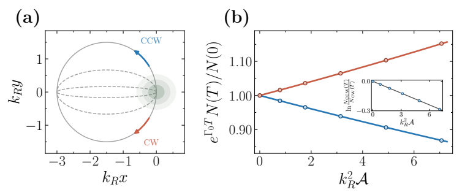

*FIG. 4. Imaginary AB transport. (a) Localized trapped mode transported along closed elliptical paths in opposite orientations, indicated by the arrows. Dashed curves show paths with smaller enclosed areas. (b) Background-loss-removed norm, eΓ0T N(T)/N(0), after one cycle as a function of the unsigned enclosed area A for clockwise and counterclockwise transport. Markers show finite-time numerical evolution retaining the full Ax, while solid curves show the adiabatic quadratic prediction. The inset shows ln[NCCW(T)/NCW(T)], with the prediction of Eq. (40). Here T ωR = 20, η/kR = 0.01, (Ωx, Ωy)/ωR = (8, 10), kRRx = 1.5, and Ry is varied to change the enclosed area.*

We add an anisotropic harmonic trap to Eq. (9),

$$
V_{\mathrm{tr}}(t)=\frac{m}{2}\left[\Omega_{x}^{2}(x-X)^{2}+\Omega_{y}^{2}(y-Y)^{2}\right],\qquad{\mathrm{(34)}}
$$

where R = (X, Y ) is the trap center. At R = 0, we prepare the stationary right mode ϕ0 that is continuously connected to the harmonic oscillator ground state as the gauge coupling vanishes. This mode is normalizable.

The trap follows an ellipse with a linear angular ramp,

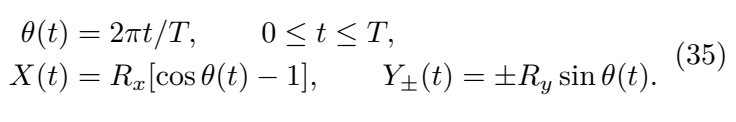

For Rx, Ry > 0, the + path is counterclockwise (CCW) and the − path is clockwise (CW). Both paths begin and end at the origin and enclose areas A± = X dY± = ±πRxRy. Fig. 4 uses the unsigned area A = πRxRy.

For the quadratic model of Eq. (9), translation of the trap by R gives the unnormalized stationary mode

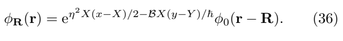

The exponential factor compensates the change in the vector potential under translation. The eigenvalue is therefore independent of R and equals E0−iℏΓ0/2, where E0 is the real energy of the centered mode. In the slow-transport limit, the state follows this mode.

We introduce the corresponding left mode, normalized by ⟨ϕR|ϕR⟩ = 1. Since the centered modes have even parity, the terms odd under spatial inversion do not contribute to the overlap, giving

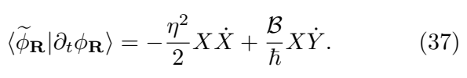

In the slow-transport limit, we write ψ ≃ c(t)ϕR(t). Projecting onto the left mode gives ċ/c = −iE0/ℏ−Γ0/2− ⟨ϕR|∂tϕR⟩ [25, 40]. For a closed path, X dX = 0, so Ax makes no net geometric contribution. The stationary mode and its norm return to their initial values. The geometric amplitude factor for the positively oriented path and the populations for the two orientations are therefore

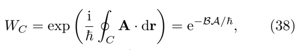

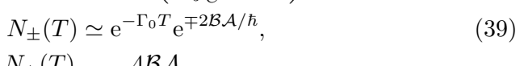

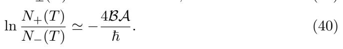

Here N = ⟨ψ|ψ⟩ is the squared norm, with N(0) = 1. In the adiabatic limit, the geometric amplitude factor depends only on the signed area A± enclosed by the path. Since the atoms move through a nonzero field, this response is a geometric AB analogue [24]. For the field orientation in Fig. 4(b), CW transport enhances the population relative to the uniform background decay, while CCW transport reduces it.

The linear ramp gives a nonzero initial trap velocity, which can produce deviations from the adiabatic result. Nevertheless, the logarithmic population ratio obtained numerically from Eq. (A23) differs from the prediction of Eq. (40) by less than 0.26% over the nonzero areas shown in the inset of Fig. 4(b).

## V. VALIDITY OF THE ADIABATIC MODEL

In this section, we test the adiabatic description by comparing evolution under the two-level Hamiltonian H2 with V = −W given by Eq. (4) with the projected dynamics governed by Eq. (A23). The projected Hamiltonian retains the full spatial dependence of the geometric vector potential, allowing us to test the single-band approximation independently of the spatial linearization used in Eq. (9).

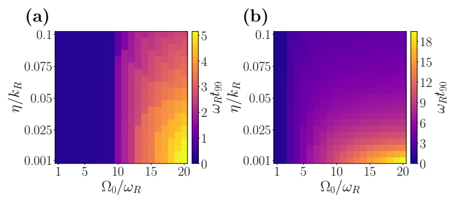

*FIG. 5. Validity of the adiabatic description. Color shows the dimensionless times (a) ωRt99 and (b) ωRt90, where t99 and t90 are the first times at which the normalized fidelity between the two-level state and the reconstructed effective spinor falls to 0.99 and 0.9, respectively. The initial Gaussian envelope is centered, with kx0 = ky0 = 0 and kRσx = kRσy = 3/√2.*

In both calculations we use the same initial state, ψ0(r)|χR−(r)⟩, where ψ0 is the Gaussian envelope given by Eq. (10). After evolving the projected envelope, we reconstruct the effective spinor |Ψeff(r, t)⟩ = ψ(r, t)|χR−(r)⟩. Its agreement with the full two-level state |Ψfull(r, t)⟩ = |Ψ2(r, t)⟩ is measured by the normalized fidelity

The normalized fidelity is independent of uniform background loss. We define tf as the first time at which the fidelity falls to a specified threshold, F(tf) = f. This time characterizes the interval over which the projected description remains accurate for the surviving atoms at the chosen fidelity threshold.

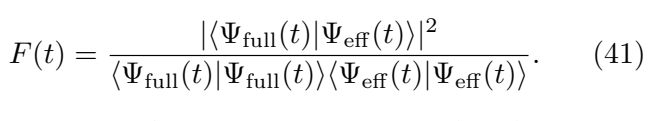

Fig. 5 shows the crossing times t99 and t90 for thresholds 0.99 and 0.9, respectively. For the centered Gaussian preparation considered, increasing Ω0/ωR extends the interval of agreement, whereas increasing η/kR shortens it. The t99 map depends primarily on the Raman amplitude Ω0, while the longer t90 window shows a stronger dependence on the field strength. The validity window at the chosen fidelity threshold can therefore be extended by increasing the Raman coupling amplitude.

## VI. CONCLUSIONS

We have proposed a dissipative Raman scheme for generating a uniform imaginary magnetic field for ultracold atoms. Complementary removal channels produce a linear differential detuning and uniform background loss, while a spatially varying Raman coupling maintains a constant dressed-state gap. The adiabatic projection gives an imaginary vector potential with nonzero curl.

For the quadratic projected Hamiltonian, nonunitary transformations reduce the dynamics to an inverted harmonic oscillator and yield exact Gaussian first moments, covariances, and surviving populations. For a packet launched along the direction of Raman recoil, attenuation produces a transverse density shift linear in time, preceding the quadratic onset of transverse momentum. The covariance depends on the initial spreads independently of the first moments. The inverted oscillator generates quadrature squeezing, while the imaginary-field coupling produces spatial correlations and rotation of the principal axes. Above the derived threshold, one principal position spread initially narrows, while the other broadens.

These results provide signatures in the density, principal spreads, and population of the surviving atoms. Spatial beam shaping and state-dependent removal offer a route to observing these effects, while interactions and controlled preparation of moving dressed states remain directions for further study.

Cyclic transport in a moving trap gives an imaginary Aharonov-Bohm response through an area-dependent change in the surviving population. Comparison with two-level dynamics identifies the interval in which the adiabatic description remains accurate and shows its dependence on the Raman coupling amplitude and imaginary-field strength.

## ACKNOWLEDGMENTS

This work was supported by the Research Council of Lithuania (Grant No. S-ITP-24-6). The authors thank Ian B. Spielman, Tomoki Ozawa and Tomas Babelis for fruitful discussions. S.A. and D.B. used resources at the High Performance Computing Center (HPCC), “HPC Saulėtekis” at Vilnius University, Faculty of Physics. D.B. also utilized the computing resources of the Scientific Computing and Data Analysis section of Core Facilities at Okinawa Institute of Science and Technology Graduate University (OIST).

## DATA AVAILABILITY

The numerical data underlying the figures are openly available in Zenodo [41]. Code is available upon request from the corresponding authors.

## Appendix A: Adiabatic projection of imaginary detuning Hamiltonian

## 1. Two-level Hamiltonian and parametrization

The two-level Hamiltonian of Eq. (4) is

$$
H_{2}=H_{0}{\bf1}+V_{\mathrm{at-l}}({\bf r})-\frac{\mathrm{i}\hbar\Gamma({\bf r})}{2}{\bf1},~~~~~~~~~~~(\mathrm{A1)}
$$

where H0 = p2/(2m)+V (r) and p = −iℏ∇. The coupling operator is

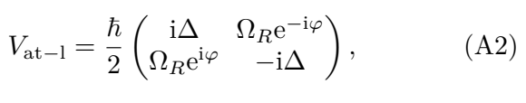

with φ = -2kRy.

− R Here m is the atomic mass, and ΩR, ∆, and Γ have units of frequency. We take ΩR > |∆| and real ∆, so that Vat−l has real, nondegenerate eigenenergies

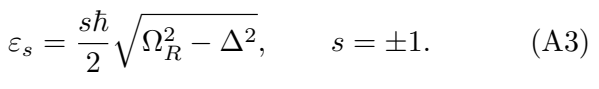

The common loss is kept separately from εs, as in the definition of the dressed states in Eq. (6).

Introduce the real hyperbolic parameter ξ and a second real phase ϕ:

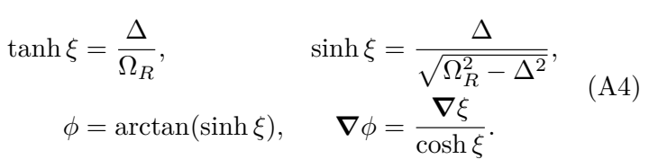

Thus φ is the Raman phase, whereas ϕ is determined by ξ.

## 2. Dressed states with unit right-right norm

The right and left dressed states can be written in terms of the two phases as

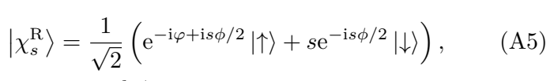

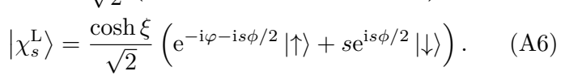

They satisfy Vat-l ∣∣χRs 〉 = εs ∣∣χRs 〉 and V † at-l ∣∣χLs 〉 = εs ∣∣χLs 〉, with

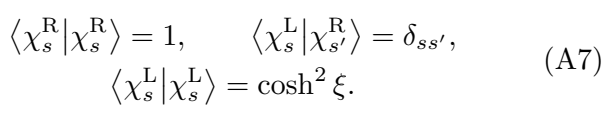

The two right eigenstates are generally not orthogonal: χRs χR−s = −is tanh ξ in this phase convention. For a single occupied dressed branch,

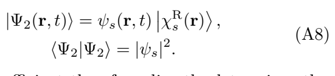

The scalar coefficient therefore directly determines the physical density.

## 3. Vector and scalar potentials

Adiabatic projection with χLs gives iℏ∂tψs = Hsψs, where

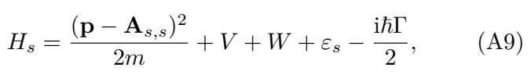

where

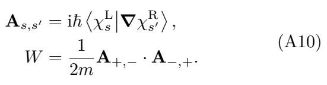

The dot product contains no complex conjugation. The common loss from H2 remains in Eq. (A9); it is not included in εs.

Differentiatsing Eq. (A5) and Eq. (A6) yields

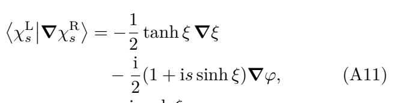

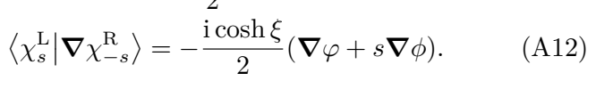

Consequently,

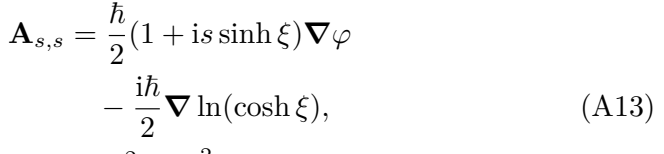

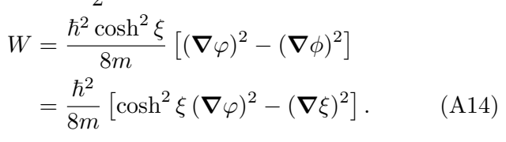

The imaginary gradient in Eq. (A13) follows from the position-dependent normalization of the right eigenstate. Rescaling a right state by f(r) and its left bra by f−1(r) changes the connection by iℏ∇ ln f; here f = (cosh ξ)−1/2 relative to a symmetric biorthogonal normalization. It has zero curl. The geometric scalar potential is real and identical for the two branches. These expressions involve no expansion in ∆/ΩR; the approximation is the neglect of transitions between dressed branches.

## 4. Magnetic field

On a region where the phases and dressed states are smooth, ∇ × ∇φ = 0 and ∇ × ∇ ln(cosh ξ) = 0. Taking the curl of Eq. (A13) gives

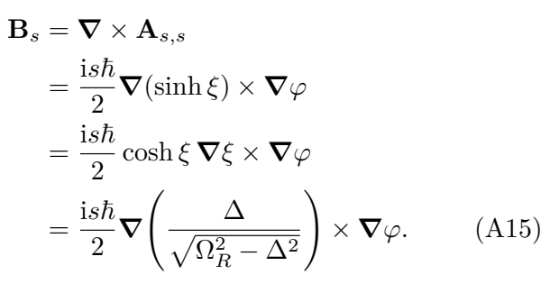

The field is purely imaginary, with opposite signs in the two branches. It requires nonparallel gradients of the normalized detuning and the Raman phase. Equivalently, directly in terms of the dressed states,

$$
(\mathbf{B}_{s})_{k}=\mathrm{i}\hbar\epsilon_{\mathrm{kij}}\left\langle\partial_{i}\chi_{s}^{\mathrm{L}}|\partial_{j}\chi_{s}^{\mathrm{R}}\right\rangle.\qquad\qquad(\mathrm{A16})
$$

Here the second derivatives cancel under antisymmetrization; repeated Cartesian indices are summed.

## 5. Uniform-field configuration

For φ = −2kRy and ξ = ξ(x), the vector potential and field are

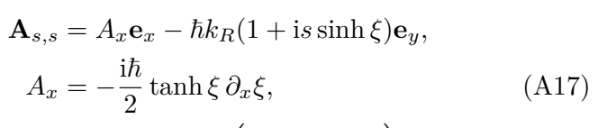

A uniform field requires sinh ξ to be affine in x. Take

where Ω0 > 0 denotes the constant dressed-state splitting in frequency units: εs = sℏΩ0/2. The hyperbolic parameter is ξ(x) = arsinh(ηx); η has units of inverse length.

The resulting potentials and magnetic field are

$$
A_{x}=-\frac{\mathrm{i}\hbar\eta^{2}x}{2(1+\eta^{2}x^{2})},\qquad\qquad\qquad\qquad\qquad\qquad\left(\mathrm{A20}\right)
$$

The constant real t − erm −ℏkRey is removed by the phase choice χRs ,L 7→ eikRy χRs ,L and ψs 7→ eikRyψs. Compensating the scalar potential with V = −W and omitting the constant eigenenergy then gives, for the lower branch,

The denominator in Ax is retained exactly; for |ηx| ≪ 1, Ax ≃ -iℏη2x/2.

x ≃ − At constant Raman amplitude ΩR = Ω0, the same linear detuning instead gives a nonuniform field,

The formal divergence occurs at the closing gap, where the adiabatic projection ceases to apply.

## Appendix B: Non-Hermitian Ehrenfest equation

Consider an unnormalized state governed by

where Hh and Hah are Hermitian. The normalized expectation is ⟨O⟩t = ⟨ψ|O|ψ⟩/N(t), with N(t) = ⟨ψ|ψ⟩. Differentiating the norm gives

For a time-independent observable, the numerator evolves as

The anti-Hermitian contributions from the bra and ket add, producing the anticommutator. Differentiating the normalized expectation gives

$$
{\frac{\mathrm{d}\langle O\rangle_{t}}{\mathrm{d}t}}={\frac{1}{N}}{\frac{\mathrm{d}}{\mathrm{d}t}}\langle\psi|O|\psi\rangle-{\frac{{\dot{N}}}{N}}\langle O\rangle_{t}.\qquad\qquad(\mathrm{B}4)
$$

Substituting Eq. (B2) and Eq. (B3) yields Eq. (19) in the main text. Its last term accounts for the changing norm. A constant loss term −ℏΓ0/2 in Hah cancels between the last two terms and therefore does not affect normalized observables. No Gaussian assumption is required in this derivation.

## Appendix C: Exact Gaussian dynamics and general initial conditions

## 1. Transformations and inverted-oscillator propagator

We solve the quadratic Hamiltonian in Eq. (9) for the initial Gaussian in Eq. (10), with ω = B/m = ℏkRη/m. The nonunitary substitution

gives iℏ∂tχ = Hχ , where

and χ(r, 0) = e−η2x2/4ψ0(r). We use the Fourier convention

Since [H, p y] = 0, each sector py = p evolves independently. Completing the square yields

The imaginary position shift is generated by the nonunitary operator

Thus χp = Tpϕp, or equivalently χp(x, t) = ϕp(z, t) with z = x + ip/(mω). The transformed Hamiltonian is

Both transformations also act on the initial state:

$$
\phi_{p}(z,0)=\mathrm{e}^{-\eta^{2}[z-\mathrm{i}p/(m\omega)]^{2}/4}\psi_{0,p}\bigg(z-\frac{\mathrm{i}p}{m\omega}\bigg)\,,\qquad(\mathrm{C7})
$$

where ψ0,p is the Fourier transform of Eq. (10). The physical time-evolved envelope in each momentum sector is therefore

The physical density and moments are evaluated after restoring both transformations.

The inverted-oscillator propagator is

The initial integration contour in the shifted coordinate is R + ip/(mω). Setting z′ = x′ + ip/(mω) gives

The surviving fraction is

where

The physical envelope follows by the inverse Fourier transform of ψp, using the convention of Eq. (C3). For the initial state in Eq. (10), both integrals are Gaussian. Completing their squares and evaluating the normalized averages gives the first moments, norm, and covariances below.

## 2. General first moments and norm

The position covariance is defined by

At t = 0, vxx(0) = σx2, vyy(0) = σ2y, and vxy(0) = 0. To state the finite-time results compactly, define

and the denominators

The first moments are given by The terms proportional to σ2x in Eq. (C15) describe the effect of initial position uncertainty, whereas those proportional to 1/σx2 describe initial momentum uncertainty. For the initial Gaussian envelope, Var(px)0 = ℏ2/(4σx2), so the factors (ℏ/2mωσx)2 account for momentum uncertainty.

Dη We have checked initial-condition consistency: the general packet satisfies N(0) = 1 and

The density remains Gaussian, with position covariance given by Eq. (C21), while the envelope momentum variance is Var(py) = ℏ2Dx/(4σ2 y Dη). For a centered packet at rest, all four first moments remain zero, although its covariance evolves and N(t) = e-Γ0t/√Dη.

The norm in Eq. (C16) obeys Eq. (B2). Initially,

## 3. Position covariance and principal directions

All position moments follow from the envelope density because ⟨χR−|χR−⟩ = 1. In particular, x2, xy, and y2 acquire no dressed-state derivative corrections. The position covariance is

with entries defined in Eq. (18). Writing q = r − (x(t), y(t))T, the normalized density is

The same Gaussian integrals give the covariance below, with ϵ, δ, c, s, and Dη as in Eq. (C13) and Eq. (C14).

$$
\times\ \left[s^{2}+(1+\epsilon)(\eta^{2}\sigma_{y}^{2}-4\delta)(c-1)^{2}\right].\ (\mathrm{C}21\mathrm{c})
$$

The result is valid on the normalizable branch Dη > 0 connected to t = 0. It depends on the initial widths but not on the initial position or momentum. Uniform loss cancels from the normalized covariance. The laboratory standard deviations are σx(t) = ∆x = √vxx(t) and σy(t) = ∆y = √vyy(t), and the uncentered second moments are ⟨rirj⟩t = vij(t) + ri(t)rj(t). The eigenvalues of v are

The eigenvalues of v are

$$
\lambda_{\pm}=\frac{v_{x x}+v_{y y}}{2}\pm\frac{1}{2}\sqrt{(v_{x x}-v_{y y})^{2}+4v_{x y}^{2}}\qquad(\mathrm{C}22)
$$

For distinct eigenvalues, the corresponding unit vectors areθ+ = 1

The two-argument arctangent fixes the quadrant. Since the variance along any unit vector n is nT vn, the maximum and minimum widths are √λ+ along e+ and √λ− along e−. These are also the axes of the Gaussian density contours. The eigenvalues are variances, rather than widths. When they coincide, no direction is preferred.

The initial covariance is v(0) = diag(σx2, σy2). For the unchirped initial state, its change begins at order t2, with

Reversing the field reverses this shear and reflects the principal axes, while leaving their widths unchanged. As η → 0 at fixed kR, both vector-potential components vanish and the covariance reduces to free expansion, vii = σi2 + ℏ2t2/(4m2σ2i ) and vxy = 0.

## 4. Principal spreads for the circular launch

For Eq. (22), set σx = σy = σ in Eq. (C15), Eq. (C16), and Eq. (C21). The short-time first moments give Eq. (23), Eq. (24), and py(t) = py0[1 + ω2t2] + O(t4). To obtain the principal-width criterion, write r = ℏ/(2mωσ2) and ϵ = η2σ2. The covariance expands as

The matrix multiplying (ωt)2 has positive trace and determinant r2(1 + ϵ)2[(1 + ϵ)r2 − 1/4]. Its smaller eigenvalue is negative precisely when 4(1 + ϵ)r2 &lt; 1, which gives Eq. (33). At equality, substitution into the finite-time covariance gives

Here Dη is evaluated at equal initial widths.

At t = 0, the angle denotes its limiting value because the initial covariance is degenerate. For other parameter values, the exact eigenvalues and directions follow from Eq. (C22) and Eq. (C23).

- [1] Y. Ashida, Z. Gong, and M. Ueda, Adv. Phys. 69, 249 (2020).
- [3] M.-A. Miri and A. Alù, Science 363, eaar7709 (2019).
- [2] E. J. Bergholtz, J. C. Budich, and F. K. Kunst, Rev. Mod. Phys. 93, 015005 (2021).
- [4] N. Hatano and D. R. Nelson, Phys. Rev. Lett. 77, 570 (1996).
- [6] N. Okuma, K. Kawabata, K. Shiozaki, and M. Sato, Phys. Rev. Lett. 124, 086801 (2020).
- [5] S. Yao and Z. Wang, Phys. Rev. Lett. 121, 086803 (2018).
- [7] J. Dalibard, F. Gerbier, G. Juzeliūnas, and P. Öhberg, Rev. Mod. Phys. 83, 1523 (2011).
- [9] G. Juzeliūnas, P. Öhberg, J. Ruseckas, and A. Klein, Phys. Rev. A 71, 053614 (2005).
- [8] N. Goldman, G. Juzeliūnas, P. Öhberg, and I. B. Spielman, Rep. Prog. Phys. 77, 126401 (2014).
- [10] G. Juzeliūnas, J. Ruseckas, and P. Öhberg, J. Phys. B: At. Mol. Opt. Phys. 38, 4171 (2005).
- [12] Y.-J. Lin, R. L. Compton, K. Jimenez-Garcia, J. V. Porto, and I. B. Spielman, Nature 462, 628 (2009).
- [11] Y.-J. Lin, R. L. Compton, A. R. Perry, W. D. Phillips, J. V. Porto, and I. B. Spielman, Phys. Rev. Lett. 102, 130401 (2009).
- [13] Y.-J. Lin, K. Jimenez-Garcia, and I. B. Spielman, Nature 471, 83 (2011).
- [15] F. Jendrzejewski, S. Eckel, T. G. Tiecke, G. Juzeliūnas, G. K. Campbell, L. Jiang, and A. V. Gorshkov, Phys. Rev. A 94, 063422 (2016).
- [14] M. Łącki, M. A. Baranov, H. Pichler, and P. Zoller, Phys. Rev. Lett. 117, 233001 (2016).
- [16] E. Gvozdiovas, I. B. Spielman, and G. Juzeliūnas, Phys. Rev. A 107, 033328 (2023).
- [18] S. Nascimbene and J. Dalibard, Phys. Rev. Lett. 135, 153402 (2025), arXiv:2412.15038 [cond-mat.quant-gas].
- [17] D. Burba and G. Juzeliūnas, Phys. Rev. Research 7, 043090 (2025), arXiv:2506.17096 [cond-mat.quant-gas].
- [19] Z. Ren, D. Liu, E. Zhao, C. He, K. K. Pak, J. Li, and G.-B. Jo, Nat. Phys. 18, 385 (2022).
- [21] E. Zhao, Z. Wang, C. He, T. F. J. Poon, K. K. Pak, Y.-J. Liu, P. Ren, X.-J. Liu, and G.-B. Jo, Nature 637, 565 (2025).
- [20] Q. Liang, D. Xie, Z. Dong, H. Li, H. Li, B. Gadway, W. Yi, and B. Yan, Phys. Rev. Lett. 129, 070401 (2022).
- [22] J. Tao, E. D. Mercado-Gutierrez, M. Zhao, and I. B. Spielman, Phys. Rev. Lett. 136, 113401 (2026).
- [24] T. Ozawa and T. Hayata, Phys. Rev. B 109, 085113 (2024).
- [23] A. Montag and T. Ozawa, Non-Hermitian Landau levels (2026), arXiv:2605.23613 [quant-ph].
- [25] J. C. Garrison and E. M. Wright, Phys. Lett. A 128, 177 (1988).
- [27] J. Dalibard, Y. Castin, and K. Mølmer, Phys. Rev. Lett. 68, 580 (1992).
- [26] A. Montag and T. Ozawa, Phys. Rev. Research 8, 013181 (2026).
- [28] A. J. Daley, Adv. Phys. 63, 77 (2014), arXiv:1405.6694 [quant-ph].
- [30] F. Reiter and A. S. Sørensen, Phys. Rev. A 85, 032111 (2012), arXiv:1112.2806 [quant-ph].
- [29] H. Feshbach, Ann. Phys. 5, 357 (1958).
- [31] S. Bravyi, D. P. DiVincenzo, and D. Loss, Ann. Phys. 326, 2793 (2011), arXiv:1105.0675 [quant-ph].
- [33] T. Hernández Yanes, M. Płodzień, M. Mackoit Sinkevičienė, G. Žlabys, G. Juzeliūnas, and E. Witkowska, Phys. Rev. Lett. 129, 090403 (2022).
- [32] G. A. Starkov, M. V. Fistul, and I. M. Eremin, Phys. Rev. B 108, 235417 (2023), arXiv:2309.09829 [quant-ph].
- [34] D. C. Brody, J. Phys. A: Math. Theor. 47, 035305 (2014).
- [36] Y. Shin, M. Saba, T. A. Pasquini, W. Ketterle, D. E. Pritchard, and A. E. Leanhardt, Phys. Rev. Lett. 92, 050405 (2004).
- [35] G. Gauthier, I. Lenton, N. McKay Parry, M. Baker, M. J. Davis, H. Rubinsztein-Dunlop, and T. W. Neely, Optica 3, 1136 (2016).
- [37] L. N. Trefethen and M. Embree, Spectra and Pseudospectra: The Behavior of Nonnormal Matrices and Operators (Princeton University Press, 2005).
- [39] E.-M. Graefe and R. Schubert, Phys. Rev. A 83, 060101 (2011), arXiv:1010.4557 [quant-ph].
- [38] L. N. Trefethen, Proc. R. Soc. A 461, 3099 (2005).
- [40] T. Ozawa and H. Schomerus, Phys. Rev. Research 7, 013173 (2025).
- [41] S. Alminas, D. Burba, and G. Juzeliūnas, Numerical data for “Imaginary magnetic fields for ultracold atoms”, Zenodo (2026), dataset.

### Notes

∗ saulius.alminas@ff.vu.lt

† domantas.burba@ff.vu.lt

‡ gediminas.juzeliunas@tfai.vu.lt

1 The possibility of creating a constant (yet real) synthetic magnetic field was previously demonstrated for the Hermitian Λ atom-light coupling scheme also using a proper atom-light coupling [10].
